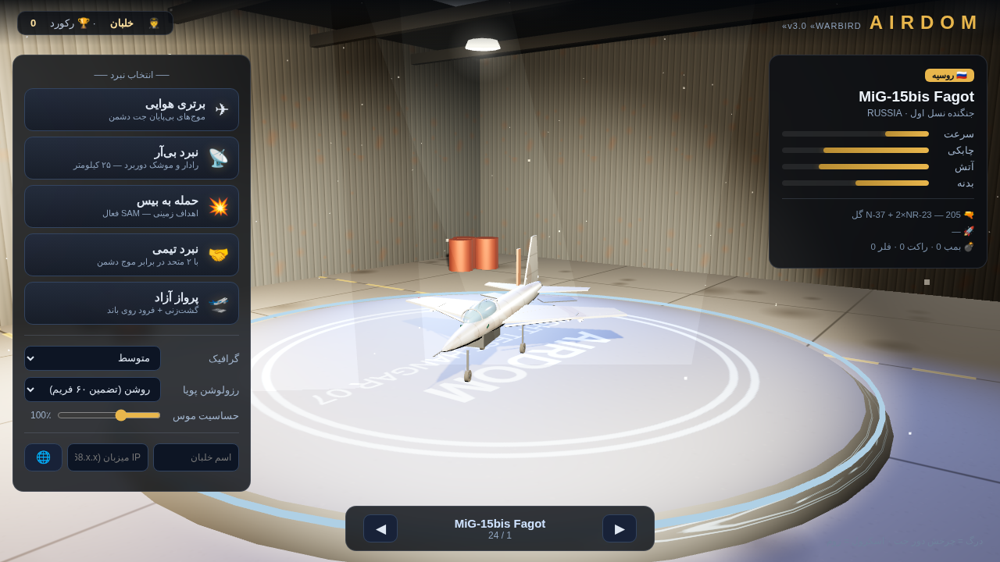
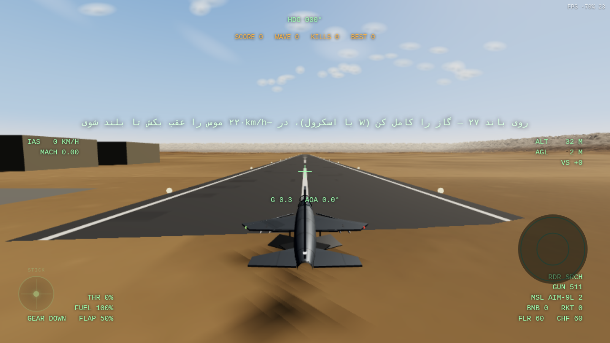
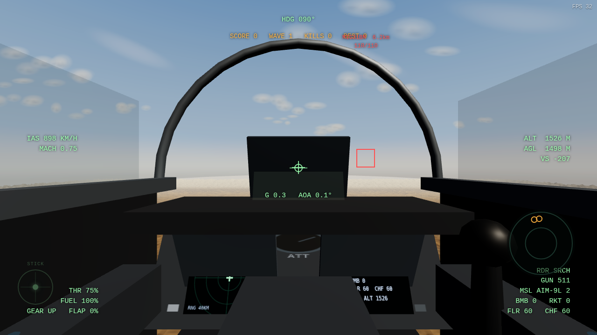
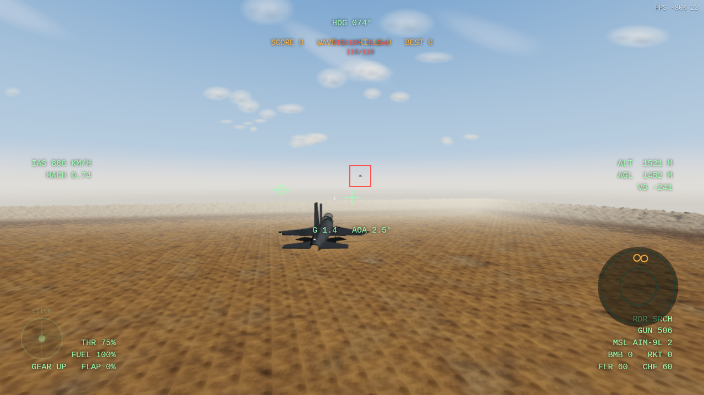
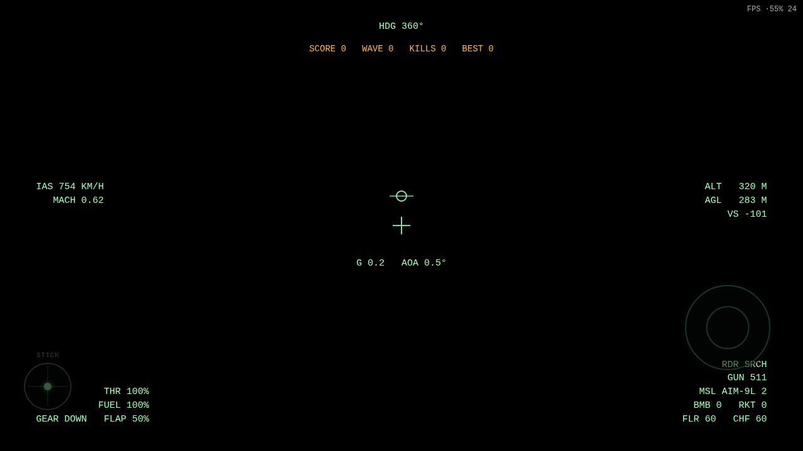
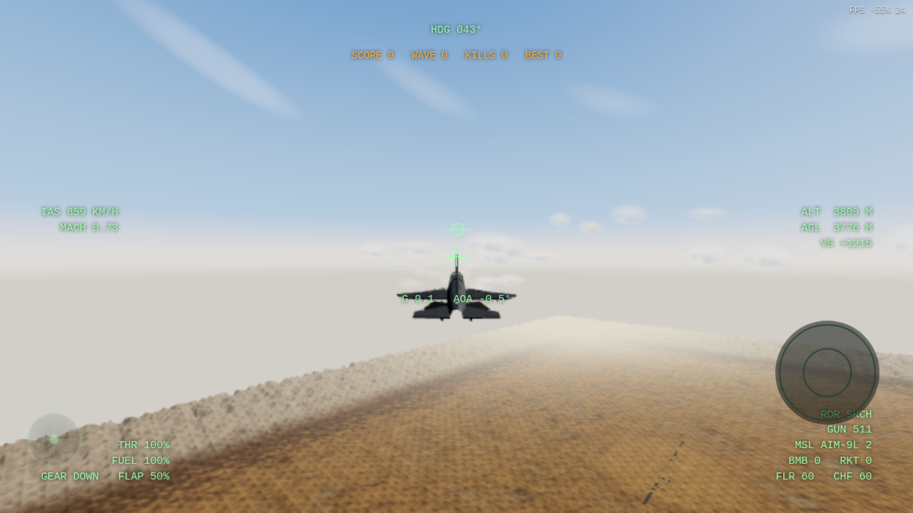

# AIRDOM — شبیه‌ساز نبرد هوایی مرورگری 🛩️

**AIRDOM** یک بازی/شبیه‌ساز نبرد هوایی سه‌بعدی است که کاملاً در مرورگر اجرا می‌شود — با فلایت‌مدل نیمه‌واقعی، **رادار و جنگ الکترونیک (BVR)**، خلبان‌های AI، تسلیحات کامل، بیس زمینیِ پدافنددار و بازی گروهی روی WiFi. هسته محاسبات سنگین (بالستیک، معادله رادار، حل پیش‌روی) روی **WebAssembly** اجرا می‌شود.

> AIRDOM is a browser-based 3D air-combat flight simulator with a WASM compute core: real radar (SRCH/TWS/STT), RWR electronic warfare, IR/SARH/ARH missiles, 24 flyable jets, War-Thunder-style mouse-aim instructor, AI dogfights, ground strike and LAN multiplayer. Built with Three.js — zero build tools for the game itself.

## 📸 تصاویر بازی

| آشیانه (منوی اصلی) | شروع روی باند — مثل وارتاندر |
|---|---|
|  |  |

| کابین سه‌بعدی + MFD زنده | داگ‌فایت |
|---|---|
|  |  |

| عبور از فرودگاه | پرواز سینمایی |
|---|---|
|  |  |

---

## 🆕 تغییرات نسخه ۳.۱ «WARBIRD»

- **رفع کامل باگ «کابین تو دیواره»** — علت واقعی پیدا شد: قاب کانوپی (torus) با چرخش π/2 اشتباه، یک حلقهٔ طولی درست وسط سر خلبان می‌ساخت (هم در کابین هم روی بدنه). حالا کابین تمیز است و قاب کانوپی از بیرون هم درست است
- **رفع وایت‌اوت لنز‑فلر** — اسپرایت‌های فلر به‌خاطر unproject با NDC غیرخطی در ۲ متری دوربین قرار می‌گرفتند و وقتی رو به خورشید پرواز می‌کردی کل صفحه سفید می‌شد؛ حالا فلرها روی پرتو واقعی ۹ کیلومتری با اندازهٔ سینمایی درست‌اند
- **شروع وارتاندری روی باند** — «پرواز آزاد» حالا روی باند فرودگاه متفقین شروع می‌شود: چرخ باز، فلپ ۵۰٪، گاز کامل (W)، در ~۲۲۰km/h دماغه بالا → برخاست واقعی
- **دوربین تعقیبی چسبنده مثل وارتاندر** — دیگر لگ/خزش کیلومتری ندارد؛ در شروع مأموریت هم فوراً پشت هواپیما سوار می‌شود
- **روشنایی بهتر بدنه** — بازتاب محیطی قوی‌تر + نور آسمان بیشتر؛ حتی از پشت هم فوزلارژ زنده است
- مه پریست‌های کم/متوسط اصلاح شد (دیگر افق شیری نیست)

## ✨ امکانات

- **۲۴ جنگنده واقعی** از نسل اول تا پنجم: MiG-15bis، F-5E، F-104S، MiG-21bis، F-4E، MiG-23ML، Mirage F1، Tornado IDS (بال متغیر)، Su-24M (بال متغیر)، A-10A، Su-25، F-14B (بال متغیر)، F-15C، F-16C، F/A-18C، MiG-29A، Mirage 2000C، Su-27S، Su-30SM (کانارد)، JAS 39C، Rafale (کانارد)، Typhoon (کانارد)، F-22A، MiG-31BM
- **جریان کامل بازی**: بارگذاری → آشیانه سه‌بعدی با چرخش دور جت → انتخاب مأموریت → پرواز → صفحه نتایج VICTORY/DEFEAT با آمار → بازگشت به آشیانه
- **آشیانه سه‌بعدی وارتاندر-سبک**: جت روی سکوی نمایش، نورپردازی استودیویی سه‌نقطه، درِ باز رو به آسمان، گردوغبار معلق، درگ = چرخش دور جت، اسکرول = زوم
- **گرافیک PBR**: بدنه MeshPhysical با کلیرکوت + بافت خطوط پنل/پرچ/کمو → **بازتاب آفتاب روی بدنه**، آسمان شیدری فیزیکی با خورشید HDR، نقشه محیط PMREM، لنز فلر، سایه‌های نرم، ابرهای کومولوس چندلایه، پریست **فوق — 4K** (سایه ۴۰۹۶ + پیکسل‌کپ ۲.۵)
- **موس = اهرم پرواز (موس‌ایم وارتاندر)**: نشانگر موس نقطه هدف پرواز است؛ «اینستراکتور مجازی» بانک و پیچ را حساب می‌کند و دماغه را به همان نقطه می‌برد — رها کنی، پرواز صاف حفظ می‌شود (با محافظت استال)
- **Ctrl = سر خلبان**: نگه‌داشتن Ctrl (یا Alt) موس را به «چرخش سر» تبدیل می‌کند؛ هواپیما مسیرش را حفظ می‌کند، سر خلبانِ سه‌بعدی هم با نگاه می‌چرخد؛ Home = وسط کردن استیک و سر
- **انیمیشن سکان‌ها**: ایلرون، اورلات، ردر، فلپ، کانارد و ترمز هوایی — همه با ورودی خلبان واقعاً حرکت می‌کنند + چرخ فرود تاشو نرم + **بال متغیر خودکار** (F-14/Tornado/Su-24 با سرعت جاروب می‌شود)
- **کابین سه‌بعدی زنده**: داشبورد، HUD شیشه‌ای، دو MFD زنده (رادار + وضعیت)، استیک متحرک با ورودی، چراغ‌های هشدار چشمک‌زن، سر خلبان که با نگاه می‌چرخد
- **هسته WASM** (`native/simcore.wat` → `src/wasm/simcore.wasm`):
  انتگرال‌گیری بالستیک دسته‌ای همه توپ‌ها/بمب/راکت/موشک‌های کور،
  معادله رادار (SNR با RCS و ناتچینگ)، حل‌گر پیش‌روی توپ — با fallback خودکار JS
- **رادار واقعی**: حالت‌های جستجو / TWS / قفل تک‌هدف (STT) با کلید N، کون آنتن، برد هر جنگنده، ترک‌های زنده روی MFD کابین
- **جنگ الکترونیک**: RWR زنده (سمت تهدید، قفل، موشک)، سه صدا هشدار، **ناتچینگ** (کراسینگ قفل راداری را می‌شکند)، **چف** و **فلر** با منطق جدا برای موشک راداری/حرارتی
- **سه نسل موشک**: حرارتی IR (فلر‌خور)، نیمه‌فعال SARH (نیاز به روشنایی رادار — قطع روشنایی = کور شدن)، فعال ARH (جوینده فعال در برد نزدیک + مسیر اوج BVR)
- **مأموریت بی‌آر (BVR)**: ۴ جت دشمن در ۲۵ کیلومتری — نبرد فراتر از دید با رادار
- **فلایت‌مدل نیمه‌واقعی**: برآر/پسا، استال و چرخش، محدودیت G با blackout، افتربرنر با شعله سوسوزن، ترانسونیک، فلپ/چرخ/ترمز، توربولانس، **برخاست و فرود روی باند**
- **خلبان AI نسخه ۲**: شلیک BVR + کرانک، ناتچ در برابر موشک راداری، فلر و پیچ در برابر حرارتی، غلت شکسته هنگام رد شدن، اجتناب از زمین
- **بیس زمینی دشمن**: هانگار، مخزن سوخت، رادار + SAM (موشک SARH قابل فریب با چف) و توپ‌های ضدهوایی با فلک
- **مأموریت‌ها**: برتری هوایی (موج بی‌پایان)، بی‌آر، حمله به بیس، نبرد تیمی، پرواز آزاد (برخاست از باند + فرود)
- **گرافیک صحرا**: واحه‌های نخل اینستنس‌شده کنار وادی‌ها، صخره، موج شنی، کوه لبه، ابر بیلبوردی، آسمان شیدری، باند با چراغ لبه
- **بازی گروهی WiFi**: میزبان شبیه‌ساز، مهمان‌ها فقط مرورگر
- **کارایی**: فیزیک گام ثابت ۱۲۰Hz، پولینگ کامل ذرات (صفر GC)، رزولوشن دینامیک، WASM برای محاسبات

## 🚀 اجرا

به‌خاطر ES Modules به یک سرور استاتیک ساده نیاز دارید:

```bash
# روش ۱: پایتون
python -m http.server 8123

# روش ۲: نود
node server/dev-server.js 8123
```

سپس `http://localhost:8123` را باز کنید.

> 💑 **بستهٔ آماده:** از [Releases](https://github.com/hadipi00/cautious-octo-enigma/releases) فایل `AIRDOM-v3.1-browser.zip` را بگیرید — شامل بازی + سرور توسعه + سرور LAN + اسکریپت‌های اجرای ویندوز/لینوکس. داخلش `شروع-بازی-WINDOWS.bat` را بزنید.

### 🌐 بازی گروهی روی WiFi

```bash
cd server
npm install        # فقط یک بار (پکیج ws)
node server.js 9090
```

- **میزبان**: بازی را باز کنید → «🌐 اتصال» → IP خودتان (مثلاً `192.168.1.5`)
- **بقیه بازیکنان**: `http://<IP میزبان>:8123` را باز کنند → اسم + IP میزبان → اتصال

## 🎮 کنترل

| کلید | عمل | کلید | عمل |
|---|---|---|---|
| ↑ / ↓ | دماغه | Space / کلیک | توپ |
| A / D | غلت | F | موشک (نوعش خودکار از قفل) |
| Q / E | دُم | B | بمب |
| W / S | گاز | R | راکت |
| Z | افتربرنر | C | فلر + چف |
| **N** | **حالت رادار: جستجو→TWS→STT** | X | ترمز هوایی |
| G | چرخ فرود | V | فلپ |
| 1/2/3 | کابین / تعقیب / دور | **موس** | **اهرم پرواز — دماغه به سمت نشانگر** |
| **Ctrl (نگه‌دار)** | **موس = سر خلبان (نگاه آزاد)** | Home | وسط کردن استیک و سر |
| I/J/K/L | چرخش سر در کابین | Esc | توقف |
| F3 | پوشش کارایی | | |

### 📡 راهنمای رادار
- **N** بین سه حالت می‌چرخد: `SRCH` (جستجو) → `TWS` (تعقیب حین اسکن — برای موشک فعال ARH کافی است) → `STT` (قفل تک‌هدف — برای SARH لازم است)
- هدف داخل کون آنتن (۶۰°) و در برد رادار باشد ترک می‌شود؛ روی MFD چپ کابین می‌بینید
- دشمن هم رادار دارد: چراغ RWR پایین-راست — مثلث قرمز = قفل روی شما، دایره = جستجو، لوزی = SAM، حلقه چشمک‌زن = موشک در راه!
- موشک راداری را می‌توان با **ناتچ** (سرعت عمود بر خط دید موشک) یا **چف (C)** کور کرد؛ موشک حرارتی را با فلر

## 🗂 ساختار پروژه

```
├── index.html              ← بوم رندر + HUD + RWR + منو
├── vendor/                 ← three.js (محلی، بدون نیاز به اینترنت)
├── native/                 ← منبع WASM (simcore.wat) + ساخت (wabt) + تست
├── src/
│   ├── main.js             ← نقطه ورود + لود WASM
│   ├── wasm/simcore.js     ← پل WASM + fallback JS
│   ├── config.js           ← همه اعداد (کیفیت، تسلیحات، ناتچینگ)
│   ├── game.js             ← مغز: مأموریت‌ها، RWR، دوربین، چندنفره
│   ├── world/              ← terrain (پروسیجرال + واحه)، sky، props
│   ├── flight/             ← فلایت‌مدل، کنترل‌ها، کلاس هواپیما
│   ├── models/             ← مدل‌ساز پارامتریک جنگنده
│   ├── combat/             ← پرتابه‌ها، رادار، افکت‌ها، AI، پدافند زمینی
│   ├── net/                ← کلاینت چندنفره
│   ├── ui/                 ← HUD + منو
│   ├── audio/              ← صدای سینتیز WebAudio
│   └── aircraft/*.json     ← ۲۴ جنگنده — جنگنده جدید = فقط یک فایل JSON
└── server/                 ← سرور LAN (Node.js + ws) و سرور توسعه
```

## ⚙️ معماری کارایی

- **WASM**: بالستیک دسته‌ای همه پرتابه‌ها در یک فراخوان، اسکن رادار همه تماس‌ها با معادله SNR، حل پیش‌روی توپ — همگی بدون تخصیص حافظه
- **GPU کم‌بار**: نورپردازی پخته، یک سایه‌مپ، مه، ابر بیلبوردی، درخت/صخره InstancedMesh
- **CPU سبک**: فیزیک گام ثابت ۱۲۰Hz، AI با LOD فکری، پولینگ کامل (صفر GC حین بازی)

## 🧪 حالت‌های توسعه

- `?debug` — دوربین مداری
- `?autotest&mission=air` — تست خودکار (در کنسول: وضعیت WASM، رادار، مهمات)
- `?autotest&mission=bvr&plane=f15c` — تست مأموریت بی‌آر
- `?sim` — شبیه‌سازی بدون رندر
- `?plane=su27s` — شروع با جنگنده دلخواه
- تست WASM مستقل: `cd native && npm test`

## 🗺 نقشه راه

- [x] هسته پرواز + تسلیحات + AI + بیس زمینی + مولتی‌پلایر LAN
- [x] **رادار واقعی + موشک‌های راداری BVR + جنگ الکترونیک (RWR/چف/ناتچ)**
- [x] **۲۴ جنگنده + هواپیماهای حمله‌ای (A-10A/Su-25)**
- [x] **هسته محاسبات WebAssembly**
- [x] **آشیانه سه‌بعدی + جریان کامل بازی (شروع/نتایج) + برخاست از باند**
- [ ] بمب افقی دقیق (CCIP) و موشک کروز
- [ ] نقشه کوهستان و اقیانوس/ناو هواپیمابر
- [ ] فرود و برخاست کامل مولتی‌نفره، اتاق‌های نبرد
- [ ] خروجی اپ ویندوز (Electron/Tauri) بدون بازنویسی

## 📄 لایسنس

کد بازی: MIT — three.js: MIT


---

## 🪟 نسخه ویندوز (بومی — Godot 4.7)

**دانلود:** [Release v1.0-windows](https://github.com/hadipi00/cautious-octo-enigma/releases/tag/v1.0-windows) → `AIRDOM-Windows-v1.0.zip` → Extract → اجرای `AIRDOM.exe`

- **فیزیک پرواز واقعی‌گرا:** اتمسفر ISA (چگالی/ماخ بر حسب ارتفاع)، منحنی برآ با واماندگی و برآ گردابی، پسای قطبی + گذار صوتی، اسپول موتور و افتربرنر، محدودیت G، ریزش بال در واماندگی، چرخ فرود با اصطکاک و ترمز
- فیزیک با تست خودکار headless راستی‌آزمایی شده: برخاست F-16 در ~۱۱ ثانیه، ماخ ۱.۳۸ در ۸ هزار پایی، چرخش بانک‌دار ۹۵ درجه در ۸ ثانیه با G≈۷.۸
- ۲۴ جنگنده (MiG-15 تا F-22)، موس = اهرم (اینستراکتور) + Ctrl = سر خلبان، آشیانه سه‌بعدی، ۵ نوع مأموریت، RWR/موشک حرارتی-راداری/فلر-چف
- سورس: `native-godot/` — تست فیزیک: `godot --headless -s scripts/autotest.gd`

## 🌐 نسخه مرورگر

نسخهٔ مرورگر (v3.1 «WARBIRD») همین ریپو است: آشیانه سه‌بعدی وارتاندر-سبک، بازتاب آفتاب روی بدنه (PBR + PMREM)، کابین سه‌بعدی تمیز (باگ حلقه کانوپی رفع شد)، لنز فلر سالم، شروع «پرواز آزاد» روی باند فرودگاه، دوربین تعقیبی چسبنده، ۲۴ جت، ۵ مأموریت + صفحه نتایج.

## 🪟 راهنمای سریع ویندوز (نسخه مرورگر)

۱. فایل `AIRDOM-v3.1-browser.zip` را از Releases دانلود و Extract کنید
۲. `شروع-بازی-WINDOWS.bat` را اجرا کنید (اگر Node دارید سرور نود، وگرنه پایتون خودکار)
۳. مرورگر خودش `http://localhost:8123` را باز می‌کند → «برتری هوایی» را بزنید
۴. برای بازی گروهی: `شروع-سرور-WiFi-WINDOWS.bat` (سرور LAN) و اتصال بقیه با IP شما
